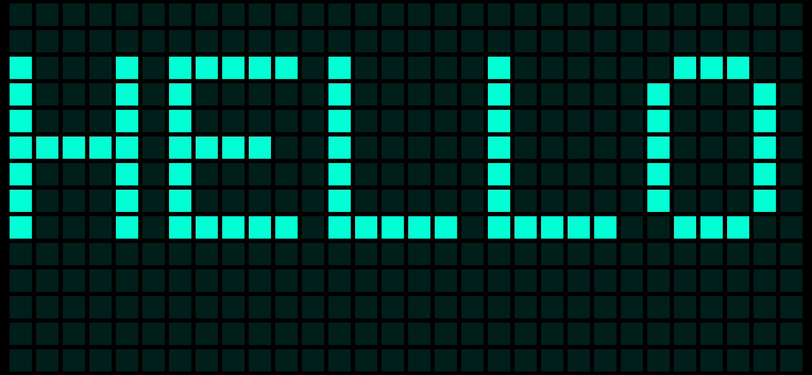
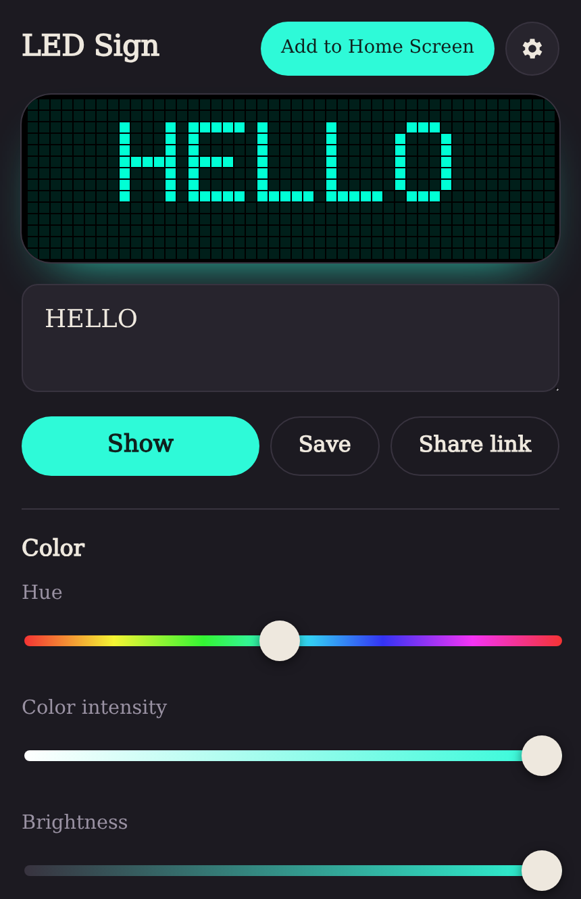
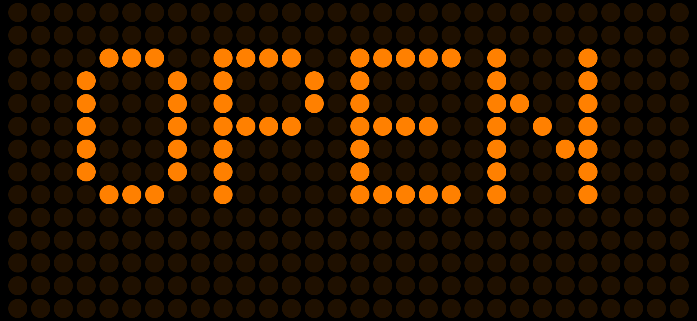

# LED Sign

A scrolling LED marquee for your phone that runs entirely on the device. Type a
message, tap Show, and hold the phone up. No account, subscription, analytics or
server-side processing; messages and settings stay in the browser.

**[Open LED Sign](https://pmarreck.github.io/led_sign/)**. It works offline
once loaded, and can be added to the Home Screen as an app.

<table>
<tr>
<td width="38%"></td>
<td>  
Pick any hue, square or round LEDs, five font styles, speed and LED size.
Messages can blink, repeat, run mirrored or inverted, and be saved or shared
as a link that opens straight into the sign.</td>
</tr>
</table>

The renderer is written in Zig and compiled to a 3 KB WebAssembly module. A thin
HTML/CSS/JavaScript layer handles the page, storage and browser features.

## How it works

1. The browser draws the message with a system font into an alpha mask exactly
   as tall as the sign has LED rows. That gives full Unicode shaping and emoji
   without shipping font files. The Mono style uses Berkeley Mono when it is
   installed; otherwise it uses a built-in 5×7 dot-matrix font scaled by a
   whole number of LEDs, because system monospace fonts at sign heights of
   about ten LEDs per character threshold into uneven strokes. Characters
   outside printable ASCII still go through the system font.
2. The WASM core (`src/core.zig`) turns the mask, elapsed time and settings into
   one RGBA value per LED: scroll position, color, ghost LEDs, invert, mirror,
   blink and repeat. It performs no I/O and is tested natively.
3. `web/led.mjs` scales that frame by a whole number of device pixels per LED,
   the same number on both axes, then masks each cell to a square or round
   light. LEDs therefore stay square (or circular) at every window size,
   orientation and device pixel ratio; leftover space is centered, never
   stretched.

## Use it

    ./run              # build, then serve http://127.0.0.1:8417/
    ./build            # optimized static site in dist/  (--debug, --test)
    ./test             # every suite: Zig core, model, actual WASM, CLI, headless browser
    bin/led-sign       # serve the built site  (--port N, --host ADDRESS, --about, --help)

All of them enter the Nix dev shell themselves (`flake.nix`). `nix run` builds
and serves the app; `nix build` produces `result/bin/led-sign` beside the static
site in `result/dist/`. `nix flake check` runs the full suite in the sandbox on
Linux, and Mechatron Prime CI, the project's self-hosted Nix continuous
integration service, builds the same package and test check on every push
(`.mechatron-prime/targets`).

`dist/` is a plain static site that works from any directory on any HTTPS
static host; offline use, screen wake lock and Home Screen installation need
HTTPS (or `localhost`). The public copy is deployed to GitHub Pages by
`.github/workflows/pages.yml` on every push to `yolo`. It first runs the same
Nix test check as Mechatron Prime CI and publishes nothing unless every suite
passes.

### Installing on iPhone

Open the site in Safari, tap Share (on newer iOS versions it may sit behind the
••• button), choose Add to Home Screen, keep Open as Web App on, and tap Add.
Websites cannot open that sheet themselves, so the app shows these steps behind
its Add to Home Screen button. Chromium-based browsers that offer an install
prompt get a direct Install button instead.

## Features and browser limits

| Feature | Status |
| --- | --- |
| Hue, color intensity, brightness, speed, LED size | Implemented |
| Fonts | Five styles: mono (Berkeley Mono or a built-in LED pixel font), sans, serif, heavy, rounded |
| Square or round LEDs, invert, mirror, blink, repeat, true black | Implemented; blink is off by default |
| Saved messages | Implemented, stored locally; works without storage for the session |
| Share | Share link: a URL fragment that opens straight into the sign |
| Start on rotation, allow portrait, use entire screen | Implemented (portrait rotates the sign unless allowed) |
| Offline use | Service worker cache, versioned by a digest of the build |
| Keep screen on | Screen Wake Lock API where available; refusal is reported |
| Fullscreen | Fullscreen API where available; otherwise a page-filling display. Home Screen mode is already full screen |
| Vibrate when finished | Only shown where the Vibration API exists (not iOS Safari) |
| Maximum hardware brightness | Not possible from a web page |
| Camera flash, iOS haptics | Not possible from a web page |
| iOS share extension | Not possible; share links cover the use case |

Messages wider than 8192 LED columns are refused with an explanation rather
than shortened.

### Verified so far

Automated: native Zig tests, model tests, tests against the compiled WASM, and
headless Chromium tests that inspect rendered canvas pixels for uniform square
and circular LEDs in portrait, landscape and several device pixel ratios, plus
offline loading (also from a subdirectory, as on GitHub Pages) and the install
flow under an iPhone user agent.

Not yet verified: Safari on a real iPhone (rendering, Home Screen install,
rotation, wake lock, offline). Until that happens, no iOS behavior should be
considered confirmed.

## Layout

| Path | Purpose |
| --- | --- |
| `src/core.zig` | Pure LED core: timing, color, validation, frame rendering, tests |
| `src/wasm.zig` | WebAssembly exports: static mask/frame buffers, `render`, `complete` |
| `web/model.mjs` | Pure settings, layout, LED tile and storage logic |
| `web/raster.mjs` | Text to alpha mask: system fonts, font detection, Mono selection |
| `web/pixelfont.mjs` | Built-in 5×7 LED pixel font with whole-LED scaling and system fallback |
| `web/led.mjs` | Canvas painter for one WASM instance |
| `web/app.mjs` | Page wiring: controls, display mode, wake lock, install, service worker |
| `scripts/` | Web build, icon generator, local static server |
| `bin/led-sign` | Serves the built site; also the Nix package's command |
| `tests/` | `unit`, `integration` (actual WASM), `cli` and `browser` suites |
| `docs/` | README screenshots |
| `.github/workflows/pages.yml` | GitHub Pages deployment of the Nix-built site |

## License

MIT. See `LICENSE`.
